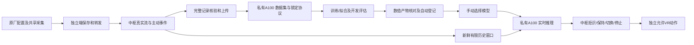

# g.Nautilus 训练、模型库与实时推理

2026-10-24 接续：已使用通过质量评估的公共原生MI数据完成12个初步分类器训练，并在模型库登记。详见[数据质量及真实训练报告](../initial_training_20261023/公共数据质量评估与初步训练验证.md)。下面“没有开展真实训练”描述的是本说明首版实施时的状态；个人g.Nautilus新数据与VR效果仍未验收。

2026-10-23。此轮补齐新设备的软件通路，真实 EEG 尚未到位，没有恢复旧权重、旧队列，也没有开展真实识别效果训练。代码、数据、任务及模型的权威记录位于新私有服务器；中枢保留原导航、页面结构和样式。

## 1. 已实现的通路

公网转发仍只连接采集端、Quest 和中枢。计算机 `172.25.56.83:5522` 由中枢通过 SSH 单独访问，模型服务只监听该服务器的 `127.0.0.1:18871`。没有向公网开放计算接口、任意 URL 转发或内网代理。

新主机 `nvtest02` 的实测设备为 A100-PCIE-40GB，UUID `GPU-b6968de0-6905-0f58-1171-d6a3d62cd44b`。依据本次用户授权使用该机；旧服务器的第二卡限制仍留在旧环境。新运行目录为 `/home/sysu/EEGMovement/gnautilus-v1`。`.venv` 为项目隔离环境，未修改已有项目的环境，未停止其它项目进程。

## 2. 数据到位后的实际操作

1. 原厂完成滤波、参考与设备设置并开始共享采集。独立端只参与自身 streaming。核对实际位置文件：通道名必须是实际头皮位置，`layout_verified=true`，参考、地和佩戴身份据实填写。不能用本说明的研究编号冒充已核验端口。
2. 在中枢训练页设置“下一次 VR 采集模式”。新版 Quest 引导范式提供四方向加明确 REST，随机顺序，每段准备2秒、提示2秒、任务8秒、间歇3或4秒。任务阶段采用中性画面，准备/提示阶段显示指导。手腿仅想象，尽量不实际移动。自主按住采集同样记录模式、眼动和肢体指令；释放后为 UNKNOWN。
3. 结束采集，确认 `closed.json` 已生成。优先使用中枢的 `data/gnautilus/YYYY-MM-DD/sessions/会话ID/`，其中含中枢主动标签。另一台电脑的原始流可以复制进 `data/gnautilus/` 保持完整；只有原始流而没有可靠标签时，不会被猜成可训练数据。
4. 打开原中枢的[训练页面](http://127.0.0.1:8765/training)。在“计算服务器连接”输入该服务器 SSH 密码。密码只在进程内存中用于连接/重连，不写入公开包或配对文件。关闭中枢后重新输入。VPN 开启时，连接按物理网卡建立单独 socket，不修改系统路由；多张物理网卡时需在 `configs/gnautilus_compute.json` 明确 `bind_address/interface_index`。
5. 在“导入完整采集记录”选择记录，填写参与者、真实日期、佩戴ID、训练或开发角色、实验模式、与记录一致的参考，以及电气策略。点击核查、上传并登记。记录未关闭、哈希变化、参考不一致、布局未确认或无闭合标签区间均显示原因。
6. 分别登记多段记录，再在“组合已登记数据集”粘贴其ID。一个组合中至少有训练和开发角色；同一参与者同一天的同次佩戴不能跨角色，同一来源不能重复或跨角色。不要把同一记录切成两份当独立会话。
7. 选择算法、历史窗口、神经网络轮数上限，点击“创建训练任务”。经典方法不伪造 epoch；神经模型显示真实逐轮损失。页面刷新、浏览器关闭不会删除服务器任务。任务失败或中断后使用“恢复任务”，日志和尝试次数保留。
8. 任务必须完成产物重新加载、预测一致性核对和模型库登记后，才显示“完成并已收录”。下方模型库按算法展示所有已登记数值分类器，不要求每项都有 `best.pt`。登记失败的任务保留已校验产物，恢复时优先重试登记，避免重训。
9. 在原模型库手动选择模型，再到原实时推理区域手动启动。实时通道顺序、采样率、参考、滤波配置及运行版本必须与合同一致。模型加载失败保留原已加载模型，但动作停止。
10. 推理已启动且实时输入有效后，另行点击允许模型动作。是否做过可选模型检查、是否取得高分均不是此按钮的资格条件。采集中暂停动作；断流、过期、失联、换配置、换模型和急停均停止。恢复连接后不自动恢复运动。

## 3. 首批数据最低条件与采集建议

软件最低条件不等于达到可靠控制：每个支持类别至少3个**不同闭合任务段**进入训练；重叠窗口不会增加试次数。训练与开发必须支持相同类别。实时导航合同需要 `REST/FORWARD/BACKWARD/LEFT/RIGHT` 五类齐全；少类模型仍可登记并离线验证，但不能伪装成完整导航分类器。融合还需要至少3个训练日期/佩戴组，组外预测用于选择融合权重；另需开发组。

建议每种模式先分4块、每块五类各一次，疲劳时结束并另建会话。分别采集中央注视下的运动想象、仅眼动、融合、明确无控制与干扰对照。为了检查摘戴变化，训练数据最好覆盖多次重新佩戴；另一天/另次佩戴作开发，再保留未查看的新会话进行独立验收。这个数量建议是起点，不保证可分性或精度。

|导航|眼动指令|运动想象|
|---|---|---|
|FORWARD|向上|左腿|
|BACKWARD|向下|右腿|
|LEFT|向左|左手|
|RIGHT|向右|右手|
|REST|自然中央注视|明确无导航意图|

`motor_only` 把眼动指令固定为中央注视；`gaze_only` 不做肢体想象；`paired` 同时执行；`no_control` 和 `interference` 使用明确无控制标签。干扰对照仍需操作者明确所做的眼动/眨眼/头动并写入备注。头皮前额记录只是眼动辅助观测，没有独立眼动仪或眼周 EOG 的地位。

`UNKNOWN` 包括准备、间歇、未标注、释放、暂停、结束与无法可靠关联的段；不会自动变为 REST。公网事件使用时钟估计范围，开始取保守上界、结束取保守下界。跨 epoch、断流或定位失败的部分不扩写持续标签。主机传输原始日志与主动任务会话是两个用途，不能把重复源同时当两个独立训练来源。

## 4. 电气策略与设备合同

导入须提供 `gnautilus.electrical.v1` 数值策略，四项均为实际确认值，界面不填旧设备默认阈值：

|字段|意义|确定依据|
|---|---|---|
|rail_uv|允许的绝对幅度上限|设备有效量程、单位及异常/饱和观察|
|flat_ptp_uv|窗口峰峰值下限|实际分辨率、平线与正常数据对照|
|max_rms_uv|窗口 RMS 上限|佩戴后正常、眼动与肌电对照|
|max_line_ratio|50Hz邻域功率比例上限，0到1|原厂陷波状态和实际工频分布|

本实现检查有限数值、量程/平线/RMS/工频，并检查整个历史窗口的设备 VALIDATION。缺失接触阻抗一直为未知，不能由设备有效位替代。当前分类器采用完整命名通道合同；电气异常时拒识整个窗口，不插零维持旧七路结构，不声称具备缺路鲁棒性。通道缺失需重新定义/训练相容模型。

原厂已经滤掉的低频无法通过软件恢复。若低频被滤掉，眼动分支的有效性应单独实验；不要为满足模型而擅自改变采集中配置。参考、滤波或采样率变更后创建新数据/模型身份。软件不自动重参考/CAR，也不做未经验证的跨库重采样。

## 5. 五类模型实际做什么

|算法|固定首版实现|需要注意|
|---|---|---|
|Bandpower＋LDA|非前额命名通道；4阶因果8–12/16–24Hz；均方功率log10；训练组标准化；0.1收缩协方差LDA|可解释基线；软最大分数未经概率校准|
|CSP＋LDA|非前额通道8–30Hz；每类对其它类正则化CSP；每类最多首2末2分量；归一化方差log10；标准化与收缩LDA|空间滤波只由训练组拟合；不是直接执行厂商受保护对象|
|前额低频＋LDA|命名Fp/AF/F区0.5–5Hz；保留带符号均值、前后四分位差和斜率|不取绝对值抹掉眼动极性；不能证明是纯脑源运动意图|
|CNN＋单向GRU|时间卷积8×17左填充；深度空间卷积16；ELU；4点池化；单向GRU32；线性输出|EEGNet风格受启发实现，**不是原版EEGNet复刻**；训练归一化只拟合训练组|
|后融合|CSP和前额分支；训练组留一组预测；从0/.25/.5/.75/1选择运动分支权重；最终分支再拟合全部训练组|界面显示分支和冲突；分支仍可能共享眼动污染，需要来源对照|

因果有限历史默认1.5秒，每100ms最多输出一次。每个窗口的滤波从同一零状态开始，训练、回放、在线使用相同函数；GRU状态也局限在该窗口，不偷偷跨窗口保持。这避免离线/在线状态不一致，但有窗口起始瞬态，是需要在真实数据中评估的取舍。[EEGNet原论文](https://arxiv.org/abs/1611.08024)介绍了紧凑空间/时间卷积动机；本项目增加因果边界和有限窗口 GRU，不能沿用论文的效果结论。

训练损失采用交叉熵，AdamW lr=.001、weight_decay=.01、batch32、梯度裁剪1，轮数由任务锁定，seed默认17。不使用开发或独立测试来拟合标准化/CSP/融合权重。训练和开发指标并列；开发已查看，不是独立验收。神经模型每个已完成 epoch 提交带优化器与随机状态的恢复点，权重内容寻址、指针原子替换；中途失败保留上个完整提交。

JEPA仅保留独立扩展位置，没有恢复旧预训练体系。此轮也没有证明轻量网络优于经典方法、左右腿稳定可分或融合一定带来增益。

## 6. 实时与离线的区别

“开发数据回放”会先停止实时推理/动作，使用相同模型适配器，保存逐窗分数及完整时间顺序报告。训练/开发的合格窗口指标按日期/佩戴组宏平均并附总体统计；连续报告另计预热、拒识、已标注覆盖、未知时长、无控制误启动次数/分钟及误运动时长。该报告的固定.75/.7决策不含中枢平滑和 Quest 执行，因此不是物理闭环效果。

在线结果保留窗口长度、计算时间、SSH往返、输入年龄和样本增量；中枢只用新样本证据做保持/切换。100ms 是输出节奏，首次识别还包括1.5秒历史积累、滤波响应、平滑和通信。输入超过250ms不再作为有效实时结果；Quest的180ms动作票据保持原限制。高延迟时系统停止，不能通过放宽约束把连通性当效果。

分类分数不解释成想走多快。当前新设备策略只允许四个基本方向，用固定已配置速度；拒识/REST/冲突阈值不满足时停止。采集端显示的执行状态来自新鲜接收端遥测；没有遥测时为 UNKNOWN，不能用中枢的运动请求冒充实际运动。

## 7. 常见问题

|现象|检查与处理|
|---|---|
|模型库空|先看是否有“完成并已收录”的新任务；旧归档不会自动出现。服务器离线会显示最后缓存及过期状态|
|任务导出后失败|查看registering阶段日志；恢复会重用已校验产物，不按文件名猜`best.pt`|
|任务中断|先恢复同源码版本服务，再点击恢复；更换源码后不能对旧协议静默续训，应保留旧 release 或新建任务|
|有数据但不能训练|查看未关闭/哈希/标签/参考/质量/分组/类别支持原因；不能靠补REST或随机切窗绕过|
|已选择但不能推理|核对原生任务模型还是完整五类导航合同；核对新鲜流、通道顺序、采样/参考/原厂配置；不要求高分验收|
|原厂MAT打不开|只支持明确数值参数合同，见接口说明；`.p`、WV或任意对象不能直接运行|
|VPN下连接失败|核对校园网访问权限、物理网卡IPv4、目标5522、固定SSH主机身份；不修改公网转发或暴露内网|
|服务重启后动作没恢复|这是停止语义。任务/模型登记仍在SQLite，加载和推理/动作需重新手动操作|

## 8. 交付与证据

服务器有 `state.sqlite`、`data/`、`datasets/`、`protocols/`、`models/`、`logs/` 和不可变 `releases/`。`systemctl --user status eegmovement-gnautilus.service` 查看本项目托管服务；重启仅限此单元，不杀其它Python/GPU进程。口令不在文档、服务单元或发布包内。

本机实现见 [gnautilus_ml](/C:/Users/19410/Desktop/EEGMovement/gnautilus_ml)、[中枢适配](/C:/Users/19410/Desktop/EEGMovement/hub/ml_runtime.py)。补充读[接口与产物合同](/C:/Users/19410/Desktop/EEGMovement/docs/gnautilus/ml_20261023/接口与产物合同.md)、[32通道及公共数据](/C:/Users/19410/Desktop/EEGMovement/docs/gnautilus/ml_20261023/32通道与公共数据.md)和[实施验证记录](/C:/Users/19410/Desktop/EEGMovement/docs/gnautilus/ml_20261023/实施记录.md)。
