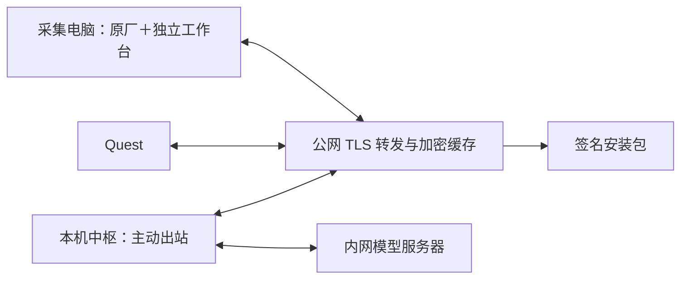

# g.Nautilus／Quest 公网版使用与故障定位

日期：2026-10-23。Windows工作台1.1.5；Quest预览修复版2.1.2（versionCode 21003）。[持续回传与详细状态](../status_link_fix_20261023/更新后回传消失与详细状态修复.md) · [Setup默认双击升级修复](../setup_upgrade_fix_20261023/双击Setup升级修复.md)。原厂共享、真实EEG与另一台采集电脑仍需单独验收。

## 连接方式

当前入口为 `https://106.55.251.83:443/eeg/`，数据连接为 `wss://106.55.251.83:443/eeg/v1/ws`。三端均主动连公网，采集电脑和Quest不再搜索本机中枢，也不需要校园网入站端口或固定内网IP。Windows工作台只保留自动公网连接，底层局域网传输组件保留兼容测试，不在工作台提供配对文件入口。

原计划的 18443 在服务器上已监听，但当前公网 TLS 超时，因此本次启用同 IP 的 443。18443 保留作备用，不能作为已验收入口。`jile.ltd` 的外部请求目前被云厂商拦截，尚未作为生产入口切换。应用使用随包专用 CA；普通浏览器不默认信任该 CA。不要通过关闭证书校验解决连接问题。

公网程序没有内网代理功能；它只接收预定义消息，不能指定任意 URL、端口、命令或内网地址。服务器服务还被 systemd 限制为只可与本机回环通信，Nginx 负责外部 TLS。

## 首次使用

1. 本机运行原有中枢启动入口，访问 `http://127.0.0.1:8765/`。原页面的连接信息中可查看公网状态；`/gnautilus`兼容地址也打开原工作台。动作维持停止，新模型维持未配置。
2. 在采集电脑双击 `EEGMovement-Setup-1.1.5.exe`，或从1.1.4检查更新。无需安装Python；原厂驱动、g.NEEDaccess和实际SDK仍由目标电脑按厂商资料安装。安装位置为 `%LOCALAPPDATA%/EEGMovement/gNautilus-app/`，以后从桌面“EEGMovement采集工作台”启动。安装器请求本安装目录内的旧程序正常关闭保存，不强杀。其他目录的旧程序仍运行时会明确提示先关闭。
3. 工作台启动后自动以“EEG采集端”角色申请连接并在本机私有数据目录保存身份，不需要选择配对文件、输入码或中枢人工批准。每种角色同时仅允许一个设备；已有同类设备在线时显示等待，先关闭旧进程。1.1.3自动迁移全部旧配对路径与局域网设置，保留设备序列号和原始记录目录，界面不再存在文件选择入口。
4. 连接模式默认“自动”；“连接中枢”可重试或检查。只有收到带端到端签名、与本次随机请求匹配的本机中枢回包才算成功。公网TLS或认证成功不足以证明中枢在线。中枢需要在线、记录关闭且动作停止，才能自动提供首次身份；状态栏会显示等待原因。
5. 原厂软件按厂商文档配置并开始共享采集；工作台填写实际序列号和 SDK 位置，选择保存目录，再开始“自身接收”。工作台只操作本客户端 streaming，不接管、不配置、不启动或停止设备采集。
6. Quest首次通过USB安装当前APK。使用 `scripts/deploy_quest_public.ps1 -DeviceSerial <序列号>`，需要安装后启动时增加 `-Launch`。脚本从本地已签名发布清单选取APK并核对SHA256，保留应用数据，不卸载、不推送身份文件。联网打开后以“Quest”角色自动连接；包名与历史签名身份保持不变。
7. Quest 和电脑的事件继续主动提交到中枢。确认记录、时间同步、事件确认和 VR 状态后再做现场任务；推理和动作仍独立手动启动。本轮没有新模型。

首次安装带自动连接功能的引导版需要一次本地安装；此后更新通过公网完成。角色由两种软件固定声明，系统维护内部身份；用户无需管理公网配对文件。

## 工作台观察顺序

| 检查点 | 通过依据 | 未通过时处理 |
|---|---|---|
| 连接路径 | 显示物理网卡、系统路由或代理 | 先用自动；必要时比较直连、系统或手动 HTTP 代理 |
| TLS | 专用CA、有效期、IP SAN全部通过 | 校准系统时间，使用当前安装包 |
| 公网认证 | 正确工作区、设备 ID、连接代次 | 排除同一身份在其他电脑或旧进程重复运行 |
| 中枢在线 | 新鲜签名回包；连接测试随机请求匹配 | 本机中枢启动并连接公网；不是更换 SDK |
| EEG 接收 | 原厂共享、实际 GetDataInfo 宽度一致 | 核对共享模式、设备组、序列号、启用通道 |
| 本地保存 | 本地块已提交，无写盘错误 | 空间不足时结束自身接收；原厂采集由原厂管理 |
| 云端保存 | cloud_durable 计数 | 网络或缓存故障；本地原始记录继续保留 |
| 中枢保存 | hub_ack 与连续 durable_seq | 中枢离线、拒收或中枢写盘故障；待补传 |
| VR／标签 | 真实回包时间、阶段及确认 | 超过时效显示未知，不用旧状态填成正常 |

设备数据有效性不是电极接触质量。接触质量、真实测得采样率及硬件时钟精度未测量时保持未知。波形显示不额外执行原厂滤波；冻结显示不停止后台保存。

1.1.5在空闲时保持持续中枢状态连接，更新检查复用该回包缓存；未开始接收时显示“EEG尚未开始接收”。开始接收或补传时释放空闲连接交给数据连接，结束后恢复。中枢原“连接信息”内可查看采集电脑、版本、SDK、实际通道、配置采样率、两端保存、队列与更新状态；回包年龄过期时明确显示历史报告，不冒充在线。

## VPN 和网络

Windows 自动模式优先尝试活动物理网卡的单个 socket 路径，再试系统路由和系统 HTTP 代理。它不关闭 VPN、不修改全局路由、不修改防火墙。界面可以明确选择直连、系统代理或手动 HTTP 代理。更新请求使用同类路径选择。

本机现有 FlClash 环境中，系统路由的约 418ms 数据往返使实时数据无法通过 250ms 新鲜度门；物理 WLAN 路径的软件联调恢复了部分实时接收。这不是所有 VPN／网卡环境的保证。路径切换后重新握手并停止动作。

三端可以位于不同 NAT 后。公网 TLS 可达即可，无需 UDP 打洞或校园网广播发现。若网络阻断 443 出站，应换可用出口或把三端接到同一路由/AP 后使用局域网模式，不能开放原厂 GDS 到校园网。

## 自动更新

Windows 启动后和每 10 分钟检查，按钮可立即检查；服务端版本通知只促使客户端重新检查签名清单。更新与波形、保存分线程。采集／补传／操作活跃时等待；安装前重新获取新鲜中枢回包并核对记录关闭、动作 STOP。中枢未知或离线时不授予安装资格。

安装包按版本目录解压，启动健康检查成功后提交版本状态；失败恢复上一指针并启动旧版本。原始数据和配对文件不放入版本目录。便携 ZIP 可运行和下载更新，但自动切换需要先运行安装器建立启动器。

Quest 自动检查、下载并校验签名清单、APK 摘要、包名、versionCode 及 APK 证书。只有任务结束、动作停止并急停锁存、应用在前台时请求安装。可能出现系统安装许可或确认窗口，在链路页点击“软件更新”进入处理。用户取消或系统拒绝都不算成功；只有新版本启动回报才确认完成。Quest 故障版本以更高 versionCode 修复，不卸载回滚。

首次检查没有后续版本时显示“当前已是最新版本”是正常结果，不代表已验证真实头显升级。公开包只有公钥和专用 CA 公共证书，不包含配对秘密、CA 私钥、离线发布私钥或厂商 SDK。

## 保存和恢复

采集电脑保存原始 float32 块、描述、提交日志和关闭清单；中枢独立保存接收到的块和事件。云端仅提供最多 24h／8GiB 临时缓存，并预留 10GiB 磁盘。达到任一限制明确拒收或到期审计，不是永久备份。

“云端已保存”不等于“中枢已保存”；两级确认都不删除采集电脑原始记录。中枢离线时可继续本地记录，恢复后按 stream／epoch／block 去重补传。历史数据不能刷新实时新鲜度或触发动作。

工作台“历史补传”选择含 `descriptor.json` 的原始流目录。不得手工改块、描述、身份或摘要以消除报错。内容冲突会隔离并停止自身接收；云端 AES 损坏块会单独隔离并记录审计，其他正常块继续补传。原始记录可以作为重新补传依据。

## 常见故障

| 现象 | 含义和处理 |
|---|---|
| 公网认证成功，中枢未确认 | 公网服务在线但中枢未回包；检查本机中枢的公网状态和 VPN 路径 |
| TLS失败 | 证书或时间不符；使用当前安装包并校准时间，不忽略验证 |
| 已有同类型设备在线／role_occupied | 每种软件同时只运行一个实例，关闭旧进程后自动重试；无须重新下载文件 |
| 双击Setup后窗口仍显示1.1.0或“中枢配对文件” | 1.1.3及更早安装器存在已有安装时跳过升级的错误，改用1.1.4；无需卸载或删除数据。1.1.4会实际升级并核对启动版本 |
| 有波形，云保存落后 | 采集已接收，本地仍保存；检查网络、积压与云容量 |
| 云保存前进，中枢保存不前进 | 中枢离线、写盘失败或块被拒绝；查看中枢日志和隔离原因 |
| 有保存但实时接受为 0 | 数据过旧或公网延迟超过新鲜度；历史保存仍有价值，不能放宽动作租约掩盖问题 |
| GetDataInfo 宽度不符 | 当前实际列和配置声明不一致；重新核对原厂配置，不能按固定 32 列硬切 |
| 无共享／独占／意外成为创建者 | 原厂会话不满足参与者条件；独立端退出，不自动接管 |
| 中枢状态变未知 | 回包过期；标签与动作按未知／停止处理，不填 REST |
| 更新等待空闲 | 结束采集与任务、保持 STOP，并让中枢回包确认；不要强制覆盖运行目录 |
| Quest 待系统确认 | 打开链路页软件更新，完成 Android 许可／安装确认；失败信息会回传 |

本机中枢日志：`hub/runtime/hub.log`。采集端界面支持查看和导出分阶段日志；事件日志不包含配对秘密。服务器检查命令与回滚说明见[公网协议、部署与发布说明](公网协议与部署发布.md)。

## 现场验收记录

- 采集电脑：原厂共享、实际列／单位／滤波回读、长时接收、拔设备及断流、空间不足。
- 网络：目标电脑实际 VPN、校园网出口、下级 NAT、断网重连、云与中枢两级确认。
- Quest：保留数据安装、系统确认、启动新版本、UI 回包、按住／松开、暂停退出、时间映射。
- 闭环：动作手动启动、180ms 票据、250ms EEG 新鲜度、重连后不自动恢复、急停。

这些项目必须实际观察并记录，不能由本机合成数据、Java 桌面 TLS 或 APK 构建替代。
